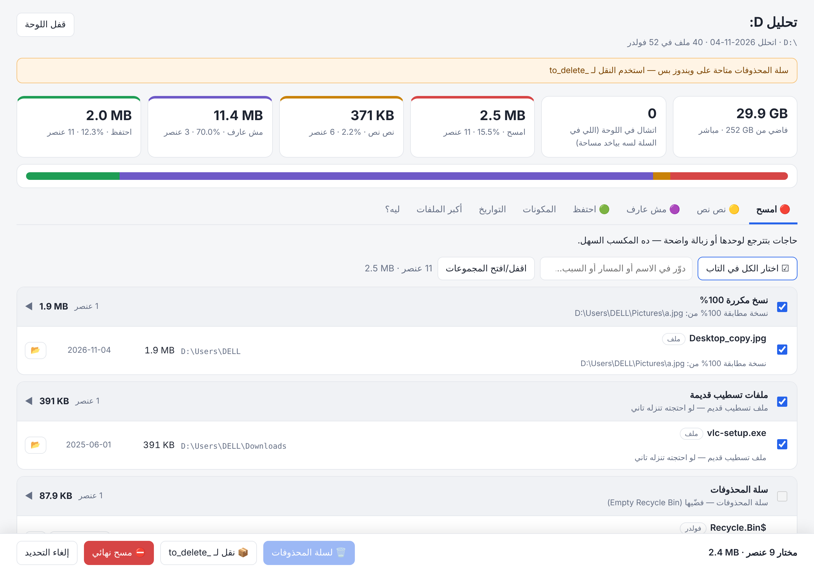

<div dir="rtl">

# 🗂️ Drive Analyzer: حلّل أي درايف، واعرف تحتفظ بإيه وتمسح إيه

سكيل (Agent Skill) بتحلل **أي درايف أو فولدر**، زي `C:` أو `D:` أو هارد خارجي أو USB أو فولدر على ماك/لينكس أو حساب Google Drive. بتطلّعلك:

- **المكونات:** حجم كل فولدر وكل نوع ملفات.
- **التواريخ:** عمر الملفات حسب آخر تعديل، وتوزيعها على السنين.
- **أكبر الملفات** و**النسخ المكررة**، والمكرر بيتأكد بالـ hash.
- **توصية لكل حاجة**، ومعاها السبب:

| | التوصية | يعني إيه |
|---|---|---|
| 🔴 | **امسح** | حاجات بتترجع لوحدها أو زبالة: كاش، ملفات مؤقتة، تحميلات ناقصة، installers قديمة، `node_modules` لمشاريع واقفة، نسخ مكررة 100% |
| 🟡 | **نص نص** | غالبًا تتشال بس بص عليها: ISO، ماشينات افتراضية، أفلام متحمّلة، أرشيفات اتفكت، موديلات AI، برامج متكركة (خطر أمني) |
| 🟣 | **مش عارف** | مش واضح إيه ده: أنواع ملفات غريبة، برامج portable. القرار ليك |
| 🟢 | **احتفظ** | ملفاتك الشخصية، والمشاريع، والنظام، والبرامج |

وبعد التحليل بتفتحلك **لوحة تحكم في المتصفح**. تختار منها الحاجات، وتعمل **🗑️ سلة المحذوفات** أو **⛔ مسح نهائي** أو **📂 افتح المكان**، من غير ما تروح تدوّر على الملفات بنفسك.



> **خصوصيتك:** كل حاجة بتشتغل على جهازك. مفيش ولا ملف ولا اسم ملف بيترفع لأي مكان، واللوحة بتسمع على `127.0.0.1` بس.

---

## 📦 التسطيب

**المتطلبات:** Python 3.8 أو أحدث، ومش محتاج أي مكتبات إضافية. على ويندوز لو مش متسطب: `winget install Python.Python.3.12`

### ويندوز: أمر واحد

افتح PowerShell والصق السطر ده:

```powershell
& ([scriptblock]::Create((irm https://raw.githubusercontent.com/omar-hesham/drive-clean/main/install.ps1)))
```

المثبّت هيعمل كذا حاجة:
1. ينزّل السكيل مرة واحدة في `%USERPROFILE%\.agents\skills\drive-analyzer`.
2. يعمل **junction** ليها في فولدر السكيلز بتاع كل agent متسطب عندك: Claude Code، وCodex، وGemini CLI، وAntigravity، وOpenCode، وZCode (GLM من Z.ai)، وCursor، وCopilot، وKimi.
3. أي تحديث بعد كده بيوصل لكل الـ agents مرة واحدة.

### من نسخة متحمّلة (clone)

```powershell
git clone https://github.com/omar-hesham/drive-clean.git
cd drive-clean
powershell -ExecutionPolicy Bypass -File .\install.ps1                  # لكل الـ agents
powershell -ExecutionPolicy Bypass -File .\install.ps1 -Agents claude,codex   # لـ agents معينين
```

### ماك / لينكس

```bash
curl -fsSL https://raw.githubusercontent.com/omar-hesham/drive-clean/main/install.sh | bash
# أو من clone:
./install.sh
```

### عن طريق `npx skills` (أي agent بيدعم Agent Skills)

```bash
npx skills add omar-hesham/drive-clean -g
```

### Claude.ai / تطبيق Claude
نزّل الريبو كـ ZIP من **Code › Download ZIP**، وبعدين ارفعه من **Settings › Capabilities › Skills**. ولو جهازك متوصل بتطبيق Claude Desktop، السكيل هتشغّل التحليل على جهازك عن بُعد (`references/windows-bridge.md`).

### تسطيب يدوي
انسخ الفولدر كله، أو اعمل له link، باسم `drive-analyzer` جوه فولدر السكيلز بتاع الـ agent:

| Agent | الفولدر (user/global) |
|---|---|
| مشترك (Codex، Gemini CLI، وغيرهم) | `~/.agents/skills/` |
| Claude Code | `~/.claude/skills/` |
| Codex (القديم) | `~/.codex/skills/` |
| Gemini CLI | `~/.agents/skills/` (أو `~/.gemini/skills/`، بس مش الاتنين مع بعض، علشان ما يطلعش تحذير conflict) |
| Antigravity | `~/.gemini/config/skills/` (والإصدارات الأقدم `~/.gemini/antigravity/skills/`) |
| OpenCode | `~/.config/opencode/skills/` (و`~/.opencode/skills/`) |
| ZCode (Z.ai GLM) | `~/.zcode/skills/` |
| Cursor | `~/.cursor/skills/` |
| GitHub Copilot CLI | `~/.copilot/skills/` |

بعد التسطيب **اقفل الـ agent وافتحه تاني** علشان يشوف السكيل.

### الإزالة
```powershell
powershell -ExecutionPolicy Bypass -File .\install.ps1 -Uninstall     # ويندوز
./install.sh --uninstall                                                 # ماك/لينكس
```

---

## 🚀 الاستخدام

### مع أي agent
اكتب طلبك عادي، والسكيل هتشتغل لوحدها:

- «حلل الدرايف D وقولّي أمسح إيه»
- «الـ C اتملى، إيه اللي واكل المساحة؟»
- «نضّف فولدر Downloads»
- «حلل الهارد الخارجي E»
- «Google Drive مساحته خلصت، حلله»
- `analyze my D: drive and tell me what I can delete`

الـ agent هيشغّل التحليل، ويقولّك ملخص، ويفتحلك اللوحة، ويسألك عن الحاجات اللي في "مش عارف".

### من غير agent (سطر الأوامر)

```powershell
# تحليل وفتح اللوحة على طول
python "%USERPROFILE%\.agents\skills\drive-analyzer\scripts\drive_analyzer.py" analyze D:\ --serve

# فولدر معين
python ...\drive_analyzer.py analyze "C:\Users\me\Downloads" --serve

# هارد خارجي متزامن مع الكلاود (من غير قراءة محتوى الملفات)
python ...\drive_analyzer.py analyze G:\ --no-hash --serve
```

التقارير بتتحفظ في `~/drive-analyzer-reports/<الدرايف>-<التاريخ>/`. **تقدر تفتح اللوحة تاني في أي وقت** بالضغط على `open-panel.cmd` من الفولدر ده.

| الأمر | بيعمل إيه |
|---|---|
| `analyze ROOT [--serve] [--out DIR] [--no-hash] [--budget SEC]` | تحليل كامل: مسح، ثم مكررات، ثم تصنيف، ثم تقرير. **بيكمّل من مكان ما وقف** لو اتقطع |
| `serve --db DIR/inventory.sqlite [--open]` | يفتح لوحة التحكم |
| `classify --db … --overrides overrides.json` ثم `report --db … --out …` | إعادة التصنيف بقراراتك من غير مسح جديد |
| `plan` / `apply [--confirm]` / `undo MANIFEST --confirm` | تنفيذ من سطر الأوامر: نقل لـ `_to_delete` مع رجوع |
| `import-gdrive FILE.jsonl` / `import-listing FILE.tsv` | تحليل Google Drive، أو ليستة ملفات من جهاز مفيهوش Python |

أي أمر معاه `--help` بيشرح كل الخيارات.

---

## 🖥️ لوحة التحكم

- **التابات:** امسح، ونص نص، ومش عارف، واحتفظ. كل تاب **متقسم مجموعات**، زي "ملفات تسطيب قديمة" و"تحميلات ناقصة" و"نسخ مكررة"، ومعروض جنب كل مجموعة حجمها.
- **التحديد:** صف صف، أو **☑ اختار المجموعة**، أو **اختار الكل في التاب**، ومعاهم **بحث**.
- **الأكشنز:**

| الزرار | بيعمل إيه | يرجع؟ | المساحة بتتحرر إمتى؟ |
|---|---|---|---|
| 🗑️ لسلة المحذوفات | سلة محذوفات ويندوز | ✅ من السلة | لما تفضّي السلة (فيه زرار) |
| 📦 نقل لـ `_to_delete` | فولدر على نفس الدرايف + manifest | ✅ بأمر `undo` | لما تمسح الفولدر |
| ⛔ مسح نهائي | مسح على طول، وبيطلب تأكيد | ❌ | فورًا |
| 📂 | يفتح المكان في Explorer | — | — |

- **ملفات النظام مقفولة 🔒**، زي Windows وProgram Files والسلة نفسها. بدالها فيه زرار للأداة الصح: "فضّي السلة" أو Disk Cleanup أو Apps.
- **السلة الآمنة:** اللوحة **بترفض** تبعت للسلة لو الدرايف USB ومالوش سلة، أو لو الحاجة أكبر من سعة السلة، لأن ويندوز في الحالتين بيمسح نهائي من غير ما يقولّك.
- **المساحة الفاضية** بتتحدّث مباشرة، وكل أكشن بيتسجل.
- **الأمان:** اللوحة بتسمع على `127.0.0.1` بس، وكل طلب محتاج توكن عشوائي. وبتتقفل لوحدها بعد 3 ساعات من غير استخدام.

---

## ⚙️ التخصيص

- **قراراتك:** أي حاجة عايز تغيّر تصنيفها، اكتبها في `overrides.json` في فولدر التقرير:
  ```json
  [{"prefix": "Games/OldGame", "bucket": "delete", "reason": "مش بلعبها"},
   {"prefix": "Work/Archive", "bucket": "keep", "reason": "أرشيف شغل"}]
  ```
  وبعدين شغّل `classify` و`report`، أو قول للـ agent.
- **القواعد نفسها** موجودة في `scripts/rules.py`، وفيه شرحها في `references/rules.md`. وتقدر تغيّر الحدود، زي عمر المشروع الواقف وعمر الـ installer القديم، من أول الملف.

---

## 🧩 هيكل الريبو

```
SKILL.md                 تعليمات الـ agent (معيار Agent Skills)
AGENTS.md                مدخل للـ agents اللي بتقرا AGENTS.md
scripts/drive_analyzer.py    الأداة (CLI)
scripts/panel.py             لوحة التحكم المحلية
scripts/rules.py             قواعد التصنيف
scripts/report_template.html واجهة التقرير/اللوحة (عربي RTL)
scripts/list_files.ps1       بديل لو الجهاز مفيهوش Python
references/                  شرح تفصيلي (Google Drive، القواعد، التنفيذ، التشغيل عن بُعد)
install.ps1 / install.sh     المثبّت
tests/                       اختبارات (python -m unittest discover tests)
```

## 🛠️ مشاكل شائعة

| المشكلة | الحل |
|---|---|
| الـ agent مش شايف السكيل | اقفله وافتحه تاني. واتأكد إن `drive-analyzer\SKILL.md` موجود في فولدر السكيلز بتاعه |
| `python` مش معروف | سطّب Python، أو استخدم `py` بدالها |
| "مالوش سلة محذوفات" | الدرايف USB. استخدم 📦 `_to_delete` أو ⛔ مسح نهائي |
| عنصر ما اتمسحش | الملف مفتوح في برنامج. اقفل البرنامج وجرّب تاني (السبب بيظهر جنب العنصر) |
| فولدرات "ماقدرناش نقراها" | دي ملفات نظام محتاجة صلاحيات Admin، وده طبيعي |
| التحليل بطيء على درايف سحابي | استخدم `--no-hash` |

</div>

---

## English quick reference

**Drive Analyzer** is an [Agent Skill](https://agentskills.io) plus a zero-dependency Python CLI. It inventories
any drive or folder, shows the space by folder, type and age, finds hash-verified duplicates, and classifies
everything into *keep / maybe / delete / unknown* with a reason for each item. It then opens a local
action panel (`127.0.0.1`, token-protected) where you can send items to the Recycle Bin, delete them
permanently, move them to a reversible `_to_delete` folder, or reveal them in Explorer. System items are
locked, and recycling is refused when Windows would silently delete for good (no bin on the drive, or the
item is bigger than the bin).

- **Install (Windows):** `& ([scriptblock]::Create((irm https://raw.githubusercontent.com/omar-hesham/drive-clean/main/install.ps1)))`
- **Install (macOS/Linux):** `curl -fsSL https://raw.githubusercontent.com/omar-hesham/drive-clean/main/install.sh | bash`
- **Any Agent Skills client:** `npx skills add omar-hesham/drive-clean -g`
- **CLI:** `python scripts/drive_analyzer.py analyze D:\ --serve`
- **Agents:** Claude Code, Claude.ai, Codex, Gemini CLI, Antigravity, OpenCode, ZCode (Z.ai GLM), Cursor, Copilot, Kimi. Ask
  "analyze my D: drive and tell me what to delete".
- **Tests:** `python -m unittest discover tests`

License: MIT
